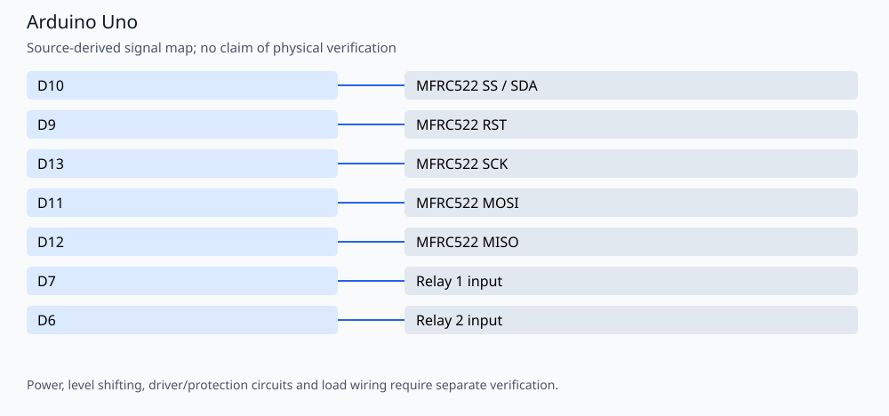

# RFID relay controller for Arduino Uno

An MFRC522 reader accepts either of the two configured four-byte UIDs. Authorized scans alternate between relay 1 and relay 2, with a one-second active-low pulse and a 1.5-second scan guard. Author: **Amir Mobasheraghdam**.

## Reproducible build

Install Python 3 and **Arduino CLI 1.3.1**, then run from this repository:

```bash
python3 tools/check_firmware.py --install
```

The helper installs `arduino:avr@1.8.6` and `MFRC522@1.4.12`. It compiles these alternatives
separately in temporary folders, without uploading or rewriting the originals:

- `src/RFID_Relais_Arduino_UNO.ino`

Build target: `arduino:avr:uno`. Once dependencies are installed, omit `--install`
to build offline. `--jobs 2` is the default. Set `ARDUINO_CLI` to a CLI executable
or wrapper when using a custom Arduino configuration. Exact build inputs are in
[`tools/firmware.json`](tools/firmware.json). Library dependencies are listed
explicitly and installed with `--no-deps` so transitive updates cannot silently
replace the pinned versions. These are tested build versions, not a claim that
all other core/library versions are incompatible.

The GitHub Actions workflow repeats the firmware checks on pushes and pull
requests. Compilation validates software/toolchain compatibility; it does not
establish hardware safety or successful physical operation.

## Signal assignments



| Signal | Board pin |
| --- | --- |
| MFRC522 SS / SDA | D10 |
| MFRC522 RST | D9 |
| MFRC522 SCK | D13 |
| MFRC522 MOSI | D11 |
| MFRC522 MISO | D12 |
| Relay 1 input | D7 |
| Relay 2 input | D6 |

## Operation and validation limits

Use a 3.3 V supply for the RC522 and verify suitable level adaptation from the Uno outputs. The relay inputs are active LOW. Keep load power separate from logic power and verify the relay module interface. UID matching is identification, not cryptographic authentication.

Edit `firstCard` and `secondCard` in the actual source; the old `card1`/`checkCard` examples did not match the sketch. Serial output uses **9600 baud**.

No physical testing, new hardware photographs or measured electrical/optical
performance is claimed. Retain the author attribution and existing license/source
notices when reusing the project.

## License

See the existing [MIT License](LICENSE).
